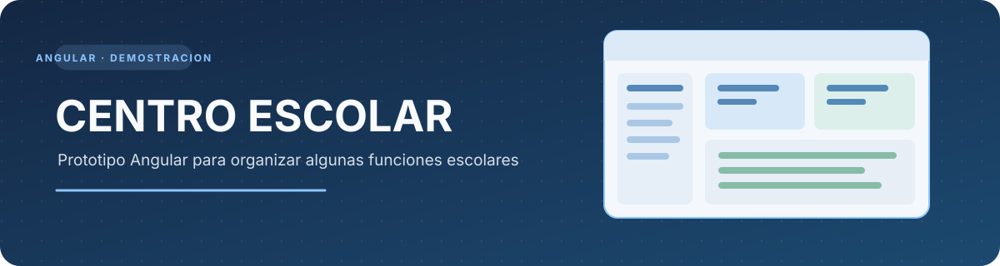
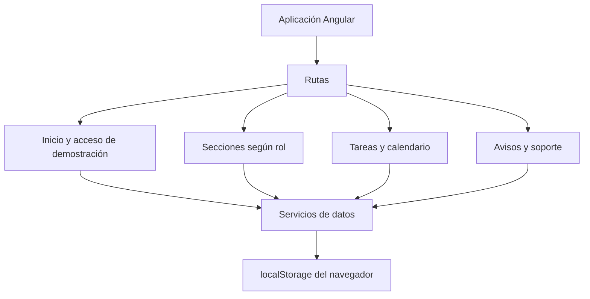

<p align="center">
  
</p>

<p align="center">
  
  
  
  
</p>

<h1 align="center">Centro Escolar</h1>
<p align="center">Prototipo Angular para organizar algunas funciones escolares.</p>

<p align="center">
  <a href="#mapa-de-la-aplicación">Mapa</a> ·
  <a href="#secciones">Secciones</a> ·
  <a href="#ejecutar-en-local">Ejecutar</a> ·
  <a href="#seguridad-y-límites">Seguridad</a>
</p>

Centro Escolar es un prototipo local que estoy usando para practicar Angular, rutas, componentes y manejo de datos en el navegador.

No tiene un servidor ni una base de datos. Todo funciona en la computadora donde se abre el proyecto.

## Mapa de la aplicación



## Secciones

| Sección | Qué permite probar |
|---|---|
| Inicio de sesión | Acceso de demostración |
| Usuarios y materias | Vistas de datos escolares de prueba |
| Avisos | Consulta de avisos |
| Tareas | Organización de pendientes personales |
| Calendario | Vista de fechas |
| Soporte | Registro de reportes de demostración |

## Cómo ejecutarlo

Necesitas Node.js 20.19 o superior.

```bash
npm install
npm start
```

Después abre:

```text
http://localhost:4200
```

Para compilar:

```bash
npm run build
```

## Cómo está organizado

La aplicación usa componentes standalone de Angular. Las rutas separan las secciones y los servicios se encargan de leer y guardar los datos en localStorage.

## Seguridad y límites

> **Importante:** este proyecto es solamente una demostración local. No lo uses para guardar información real de alumnos o personal escolar.

La sesión y los datos están en el navegador. No tiene autenticación segura en servidor, contraseñas protegidas ni permisos que puedan considerarse seguros. Los usuarios son únicamente para probar la interfaz.

Para convertirlo en una aplicación real habría que crear un backend, conectar una base de datos, implementar autenticación segura y validar los permisos desde el servidor.

## Qué me ayuda a practicar

Rutas, componentes, servicios, almacenamiento local, organización de pantallas y separación de responsabilidades en Angular.

<p align="center"><sub>Prototipo de aprendizaje · Los datos son locales y de demostración.</sub></p>
